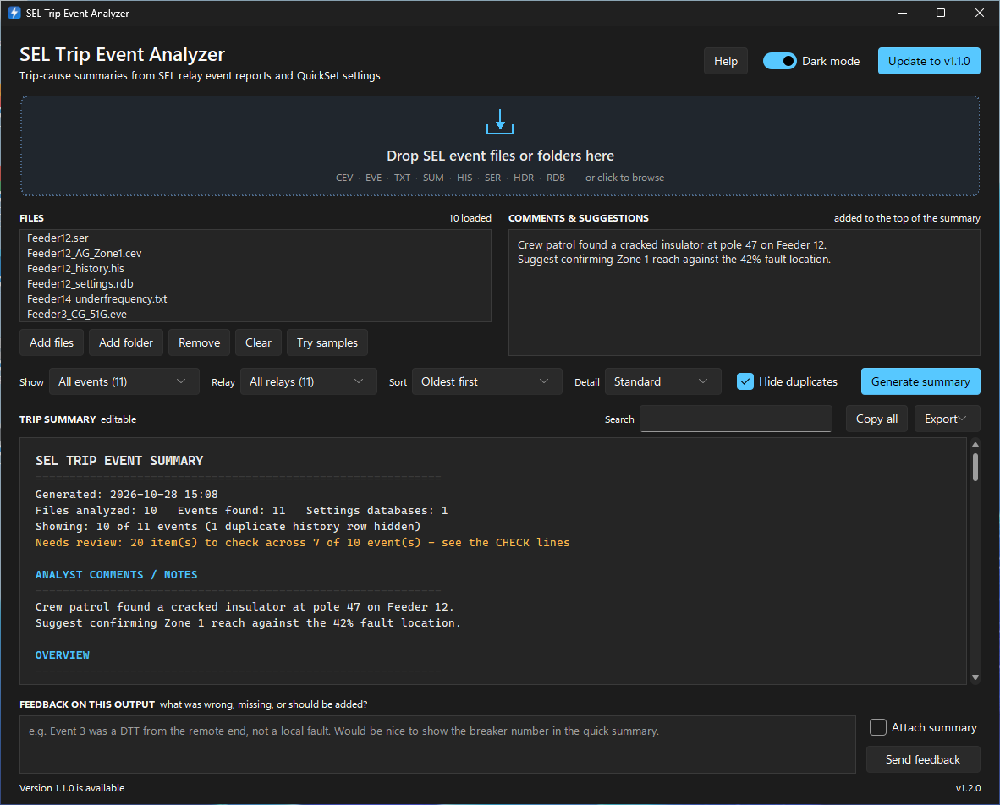
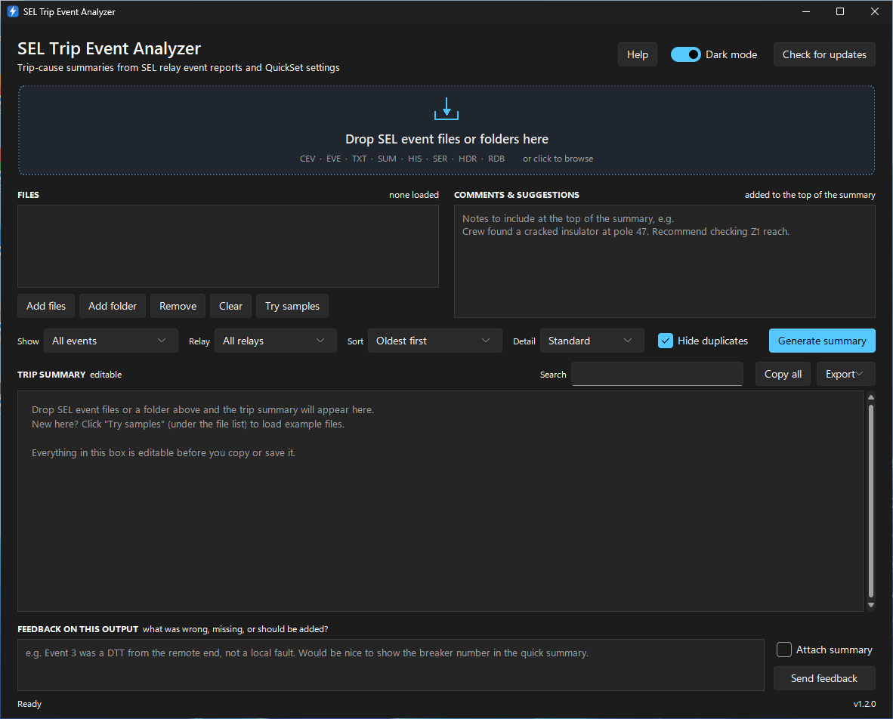

# SEL Trip Event Analyzer

A Windows drag-and-drop tool that reads SEL relay event files and AcSELerator
QuickSet `.rdb` settings databases, then writes an editable, copy-and-paste
summary of what caused each trip.

| Update waiting | First launch |
|---|---|
|  |  |

## Download

Grab `SEL_Trip_Analyzer.exe` from the [latest release](../../releases/latest).
No install is needed. Put it in a folder you own (Desktop, Documents) so the
built-in updater can replace it.

## Using it

- Drag files or whole folders onto the drop zone, or click it to browse. You
  can also drop files onto the `.exe` icon.
- Event data: `.CEV .EVE .TXT .SUM .HIS .SER .HDR`. Settings: `.RDB`.
- Anything typed in **Comments & suggestions** is added to the top of the
  summary. Press F5 or **Generate summary** to refresh.
- The summary is editable and colour-coded (trips in red, no-trip events in
  green). **Copy all** puts plain text on the clipboard; **Save .txt** writes a file.
- **Feedback on this output**: type what was wrong, missing, or should be
  added, then **Send feedback**. It opens a pre-filled issue on this repo in
  your browser (click *Create* to submit; needs a free GitHub account), and a
  copy is always saved to `%APPDATA%\SEL Trip Analyzer\feedback.log`. Tick
  *Attach summary* to include the output; issues are public, so you're asked
  to confirm first.
- **Dark mode** switch in the top corner. It follows your Windows setting on
  first launch and remembers your choice after that.
- **Check for updates** looks at this repo's latest release. When a newer
  version exists the button turns blue and reads *Update to vX.Y.Z*. Clicking it
  shows the release notes and asks before downloading. On yes, it downloads the
  new `.exe`, verifies its SHA-256, swaps it in and restarts.

Shortcuts: `Ctrl+O` add files, `F5` / `Ctrl+Enter` generate, `Ctrl+Shift+C`
copy summary, `Ctrl+D` dark mode, `Delete` removes selected files.

The summary covers, per event: relay ID, date/time, decoded event type
(`AG T` = A-to-ground fault, tripped), fault location (as % of line when `LL`
is known), decoded targets, fault currents and voltage sag, probable cause,
element timeline from CEV digital data, breaker clearing time, and which terms
of the `TR` trip equation asserted.

CEV files give the best results. Load the `.rdb` alongside so `TR` and `LL`
are known (matched by RID; a single loaded RDB applies to all events).

The interpretation is automated, so confirm it against the oscillography.

## Releasing a new version

1. Bump `VERSION` in `sel_trip_analyzer.py` (e.g. `1.0.1`) and commit.
2. On GitHub, go to **Releases > Draft a new release**, create tag `v1.0.1`,
   write what changed (users see these notes in the update prompt), and publish.
3. GitHub Actions builds the `.exe` on Windows (about 3 minutes) and attaches it
   to that release. Installed copies will then offer the update.

## Building locally

Install Python 3.9+ (tick "Add python.exe to PATH"), then double-click
`build_exe.bat`. The program lands in `dist\SEL_Trip_Analyzer.exe`.

To run from source: `pip install tkinterdnd2 olefile sv-ttk` then
`python sel_trip_analyzer.py`. When run from source, the updater replaces the
`.py` file with the release's version instead.

Command line: `python sel_trip_analyzer.py --cli <files or folders>` prints the
report to the console.
