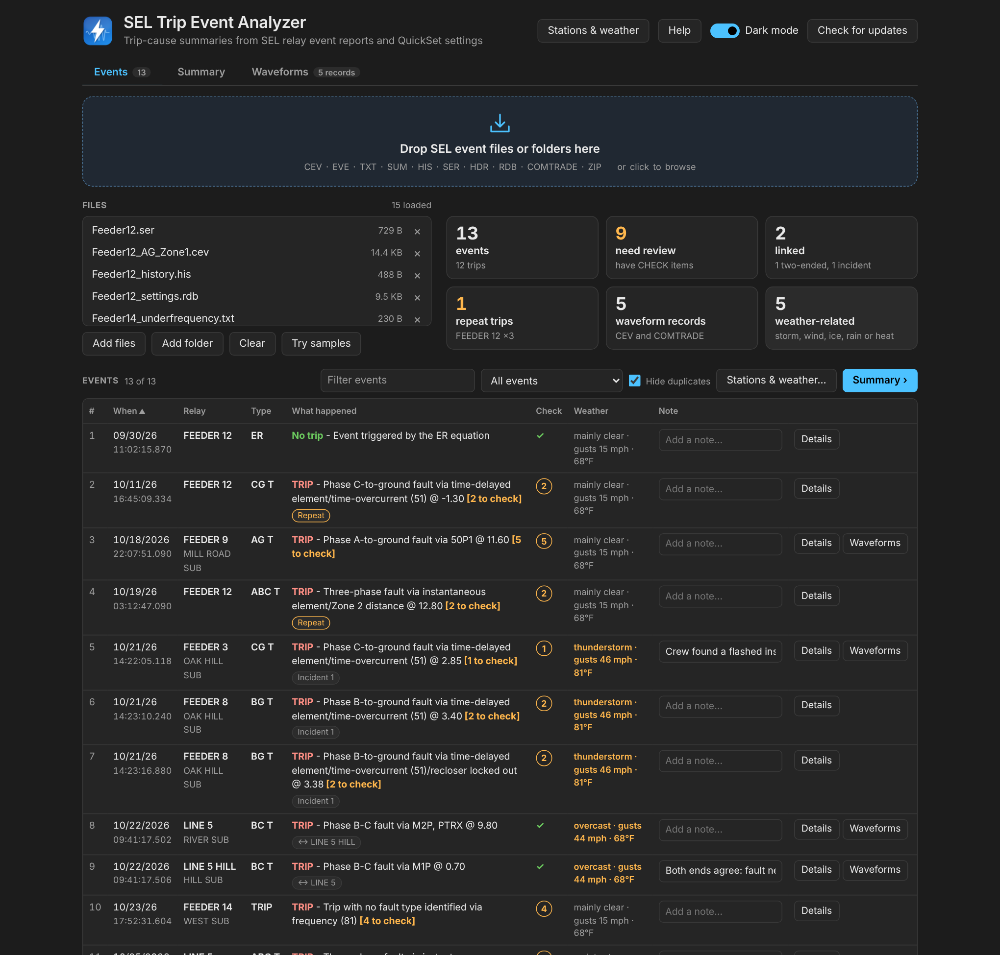
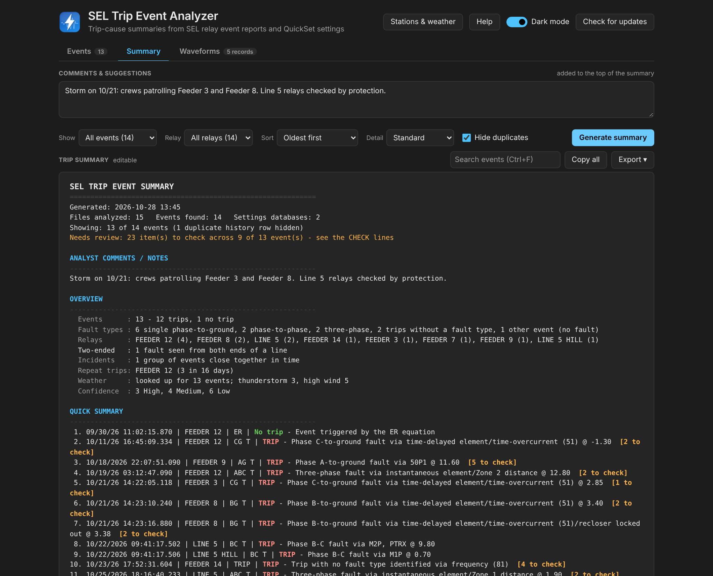
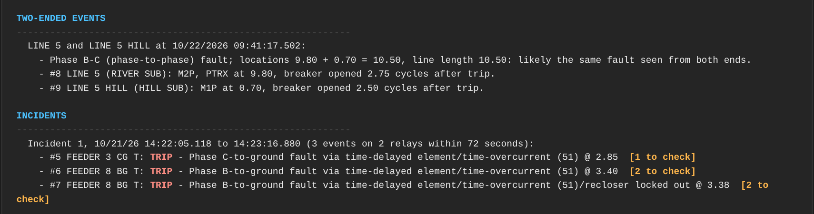
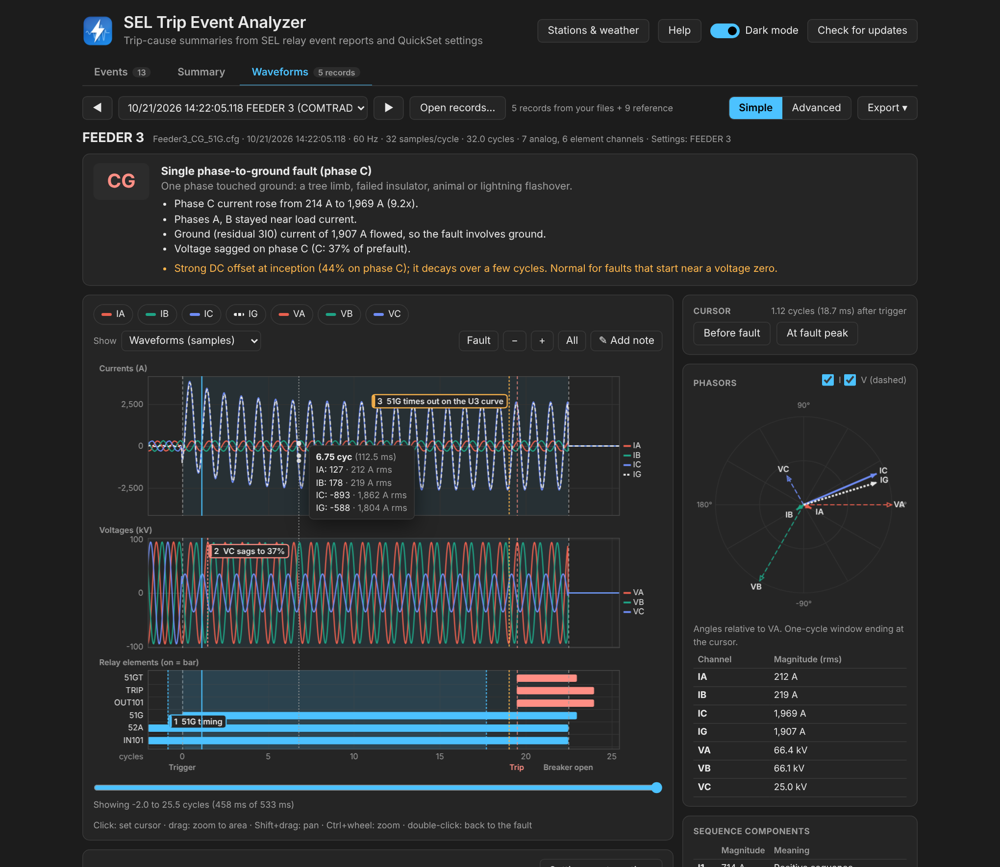
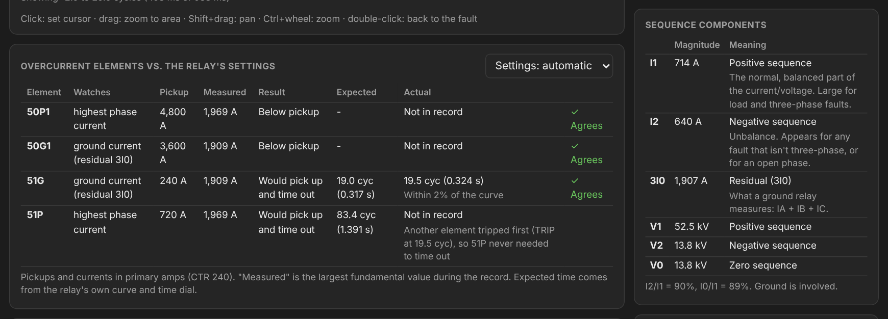
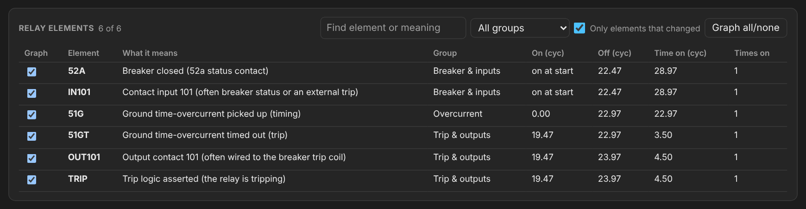
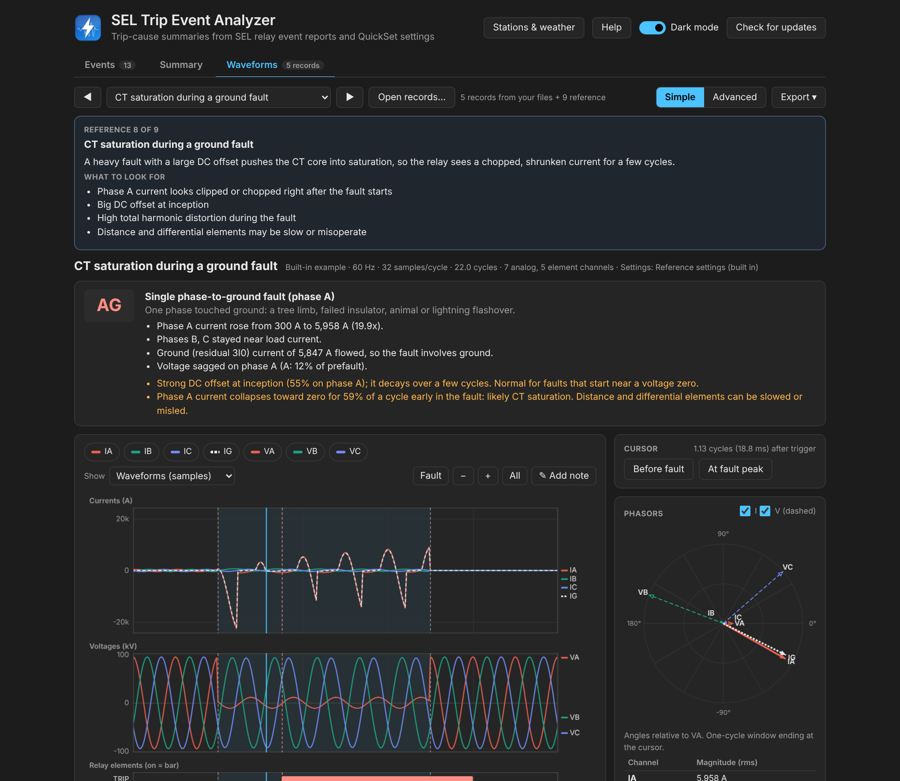
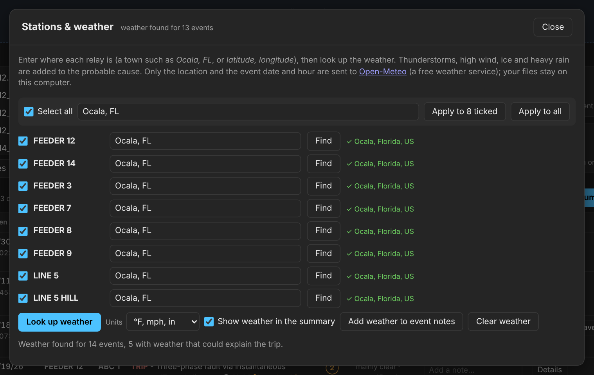
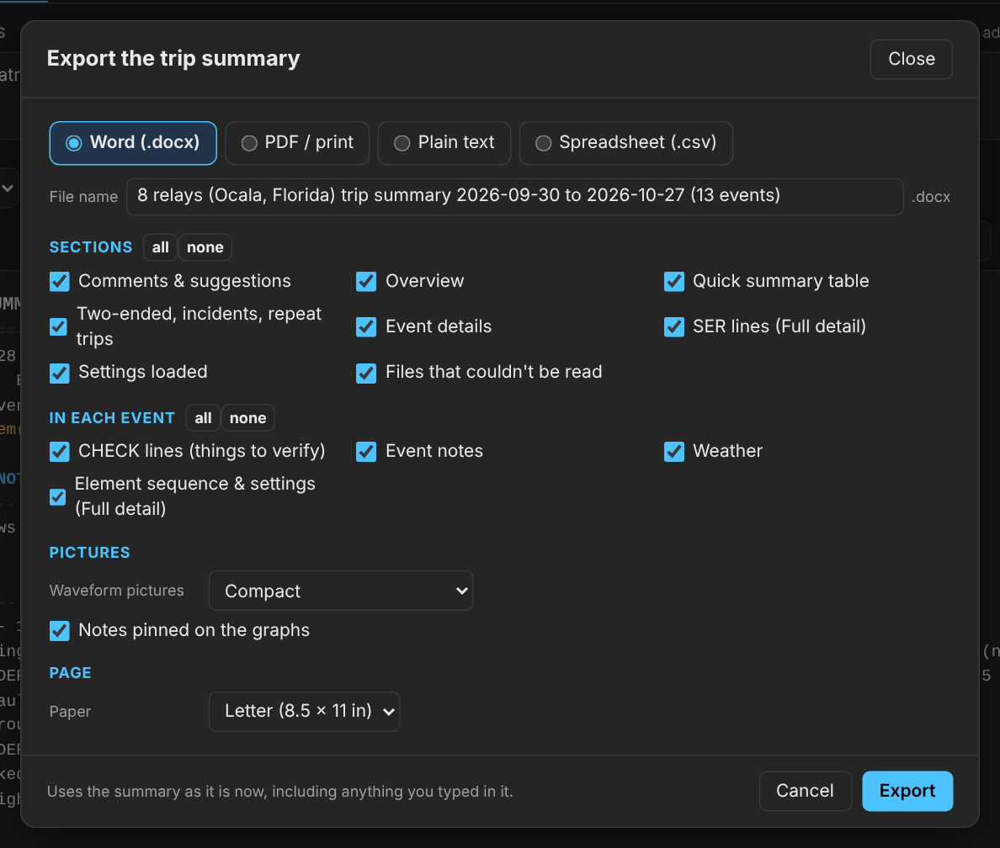

# SEL Trip Event Analyzer

**Find out what tripped and why, in plain English.** Drop in SEL relay event
files and get an editable trip summary ready for an outage report. Open any
`.CEV` or COMTRADE record to see the waveforms, phasors, harmonics and every
relay element, and to check the overcurrent elements against the relay's own
settings.

  <a href="https://kefirman9000.github.io/sel-trip-analyzer/"><b>▶ Open it online</b></a> ·
  <a href="https://github.com/kefirman9000/sel-trip-analyzer/releases/latest/download/SEL_Trip_Analyzer.html"><b>⬇ Download (one .html file)</b></a> ·
  <a href="https://github.com/kefirman9000/sel-trip-analyzer/releases/latest/download/SEL_Trip_Analyzer.exe">Windows program</a> ·
  <a href="https://github.com/kefirman9000/sel-trip-analyzer/releases/latest/download/SEL_sample_files.zip">Sample files</a> ·
  <a href="https://github.com/kefirman9000/sel-trip-analyzer/issues/new">Feedback</a>

Nothing to install, no account, and **your files never leave your computer**.

## Contents

- [What it does](#what-it-does)
- [Get started](#get-started)
- [Files it reads](#files-it-reads)
- [Three pages](#three-pages)
- [Events](#events)
- [Summary](#summary)
- [Waveforms](#waveforms)
- [Notes and weather](#notes-and-weather)
- [Exporting](#exporting)
- [Web page or Windows program?](#web-page-or-windows-program)
- [Codes and terms](#codes-and-terms)
- [Shortcuts](#shortcuts)
- [Troubleshooting](#troubleshooting)
- [Privacy and limitations](#privacy-and-limitations)

## What it does

| | |
|---|---|
| **Trip summary** | Fault type, faulted phases, location (and % of line), the element that tripped, breaker clearing time and the probable cause, for every event. Anything uncertain gets a `CHECK:` line and a High / Medium / Low confidence. |
| **Connects events** | Pairs the **two ends of a line** that saw the same fault, groups **incidents** (several relays in a storm, a reclose sequence) and flags **repeat trips** on the same relay. |
| **Waveform analysis** | Synchronized current, voltage and relay-element graphs with zoom, scroll and a cursor; phasors; sequence components; harmonics; fault type from the waveforms; 50/51 elements checked against the relay's settings and curve; every element explained. |
| **Reference library** | Nine built-in waveforms to learn from: normal load, every fault type, high-impedance fault, transformer inrush, CT saturation, evolving fault. |
| **Notes** | A note on any event, and notes pinned to points on the graph. Both go into the exports. |
| **Weather** | Optional: the weather at the hour of each event; thunderstorms, high wind, ice and heavy rain are added to the probable cause. |
| **Organize** | Filter (trips, needs review, faults, one relay), sort, search, and choose how much detail to show. |
| **Export** | Word (with waveform pictures), PDF, Excel spreadsheet or text, choosing exactly what to include. Files are named after the relay and dates. |

## Get started

1. **[Open it online](https://kefirman9000.github.io/sel-trip-analyzer/)**, or
   **[download SEL_Trip_Analyzer.html](https://github.com/kefirman9000/sel-trip-analyzer/releases/latest/download/SEL_Trip_Analyzer.html)**
   and double-click it to use it offline. It works in Chrome, Edge, Firefox and
   Safari, on Windows, Mac or Linux.
2. **Drag your event files, a folder, or a .zip** onto the page. Every event
   appears in the **Events** table straight away.
3. Open the **Summary** for the written report: read the CHECK lines, edit the
   text if you need to, and **Export**.

New to it? Click **Try samples** to load a set of made-up events that show
every feature, then look through the three pages.

## Three pages

| Page | What it's for |
|---|---|
| **Events** | Load files, see every event in one table, add notes, jump to the details or the waveforms |
| **Summary** | The written trip summary: organize it, edit it, copy or export it |
| **Waveforms** | Dig into one record: graphs, phasors, harmonics, settings check, every relay element |

Switch with the tabs or `Alt+1` `Alt+2` `Alt+3`. **Stations & weather** (top
right) is where you set where each relay is and look up the weather.

## Files it reads

| File | What it is | What you get |
|---|---|---|
| `.CEV` | SEL compressed event report | **Best.** Element timeline, currents, voltages, waveforms, usually the settings |
| `.CFG` + `.DAT`, or `.CFF` | COMTRADE record (IEEE C37.111, 1991 to 2013, ASCII or binary) from **any** relay or recorder: SEL, GE, ABB, Siemens, DFRs… | Waveforms and elements on the Waveforms page |
| `.RDB` | AcSELerator QuickSet settings database | Trip equation (TR), line length (LL), CT ratio, 50/51 pickups, curves and time dials |
| `.SET`, `.TXT` | Settings saved as text (`SHO` command output, or a QuickSet text export) | Same as an RDB |
| `.EVE` `.TXT` | Text event report or saved terminal capture | Event type, targets, location, currents |
| `.SUM` `.HDR` | Event summary / COMTRADE header written by the relay | Same as above |
| `.HIS` `.CHI` | Event history | One line per event |
| `.SER` | Sequential events recorder | Element on/off times |
| `.LOG` | Saved terminal log | Whatever event reports it contains |
| `.ZIP` | A zip of any of the above, with or without folders | Everything inside is read |

**For the most reliable result, load the event's `.CEV` together with the
relay's `.RDB`.** Settings are matched to events by relay ID (RID), so you can
load files from many relays at once. For COMTRADE, the relay ID is the device
name in the `.CFG`.

To get a CEV, download the event from the relay with AcSELerator QuickSet and
choose the compressed (CEV) format, or save the output of the `CEV` command from
a terminal session.

## Events

The first page. Drop files anywhere on the window (or use **Add files**, **Add
folder**, or **Try samples**).

- **At a glance**: how many events and trips, how many need review, linked
  events (two-ended and incidents), repeat trips, waveform records and
  weather-related trips. Click a card to show just those events.
- **The events table**: one row per event, with what happened (TRIP in red),
  tags for **two-ended** (↔ the other end), **Incident n** and **Repeat**, the
  number of items to check, the weather, and a **note** you can type straight
  in. Click a column heading to sort, or filter by text or by type of event.
- **Details** jumps to that event in the Summary; **Waveforms** opens its graphs
  (including a COMTRADE record that matches the event's relay and time).

## Summary

The written report. It has an **Overview**, a **Quick summary** (one line per event), any
**two-ended events**, **incidents** and **repeat trips**, then the **Event
details**: event type, targets, location, currents, voltages, notes, weather,
the **probable cause** and the **`CHECK:` lines**.

**Confidence**: **High** (element data and settings, nothing looked wrong),
**Medium** (some data missing, or one item to check), **Low** (history row only,
or several items to check).

| You'll see a CHECK like... | What to do |
|---|---|
| *No settings for this relay* | Add the relay's `.RDB` (or settings text) |
| *History row only / no relay element data* | Load the `.CEV` for that event |
| *Targets show phase B but the event type says A* | The record disagrees with itself: open it on the Waveforms page |
| *Highest fault current is on phase …* | The fault type may be misclassified: check the waveforms |
| *Location beyond the end of the line* / *negative location* | Fault likely past the remote bus or behind the relay: check directionality and adjacent sections |
| *Breaker took … cycles to open* | Check the breaker and trip circuit |
| *Tripped without identifying a fault type* | Confirm transfer trip, manual/SCADA open, or an external trip input |
| *Settings assumed / none match relay* | Make sure the right settings file is loaded |

**Comments & suggestions** at the top are added to the start of the summary.
**Organize it** with the row of controls above it:

| Control | Choices |
|---|---|
| **Show** | All events · Trips only · Needs review · Faults only · No-trip events |
| **Relay** | All relays, or one |
| **Sort** | Oldest first · Newest first · By relay · Needs review first |
| **Detail** | Summary only · Standard · Full (adds element timeline, settings and SER) |
| **Hide duplicates** | Skip history rows that repeat a detailed report |
| **Search** | Events whose details or notes contain the text (`Ctrl+F`) |

The summary box is **fully editable**; what you see is what gets copied or
exported. If you change the view after editing, it asks first.

## Waveforms

Click the **Waveforms** tab (`Alt+3` or `Ctrl+G`), or **Waveforms** on an
event's row. Choose a record from your files or the reference library and step through
them with ◀ ▶ (`Page Up` / `Page Down`).

- **Fault type** from the currents and voltages, with the evidence, compared
  with what the relay reported. Warnings for DC offset, **CT saturation**,
  **inrush**, **evolving** and **high-impedance** faults.
- **Graphs**: currents, voltages and relay elements on one time line, with
  trigger, trip and breaker-open markers and the fault shaded.
  Click to set the cursor · drag to zoom in · `Shift`+drag to pan ·
  `Ctrl`+wheel to zoom · double-click to go back to the fault · click a channel
  to hide it. **Show**: raw samples, **fundamental only** (filters out DC offset
  and harmonics) or **RMS trend**.
- **Phasors** and **sequence components** at the cursor, with what they mean
  (negative sequence = unbalance, zero sequence = ground involved).
- **Harmonics**: 2nd (inrush), 3rd (arcing, saturation), 5th, THD and DC offset.
- **Overcurrent elements vs. the relay's settings**: each 50 element's pickup
  against the measured current, and each 51 element's curve time (from its curve
  and time dial) against when it actually timed out.

  
- **Relay elements**: every element in the record in plain English with its
  on/off times. Search, filter by group, tick to put it on the graph.

  
- **Simple / Advanced**: Advanced adds angles, secondary amps, multiples of
  pickup, all harmonics up to the 15th, a 1/2/4-cycle window, every element and
  a samples export.

## Notes and weather

**Event notes.** Type a note in an event's row on the **Events** page (*"Crew
found a burned crossarm at pole 112"*), or in **Event notes** on the Waveforms
page. It appears in that event's details and exports, and you can search for it.

**Notes on the graph.** On the Waveforms page, click **✎ Add note**,
then click on any graph (currents, voltages or relay elements) to pin a note to
that moment, or drag across the graph to mark a stretch of time. Each note has a
colour, sits on the graph you choose, and can draw its line across all graphs,
on its own graph only, or not at all. **Drag a note** to move it in time or onto
another graph; click it to edit or delete it. Notes are included in the picture
and Word exports.

**Weather.** Click **Stations & weather** (top right, or on the Events page) and enter where each relay is
(a town like *Ocala, FL*, or *latitude, longitude*). To set many at once, tick
them (or **Select all**), type one location and click **Apply to ticked** or
**Apply to all**. Then click **Look up weather**.

Each event gets a *Weather* line for that hour, and when the weather could
explain the trip it's added to the probable cause and shown in amber in the
Events table:

| Weather | Added to the cause |
|---|---|
| Thunderstorm | Lightning is a likely cause: check arresters, look for flashed insulators |
| Gusts of 30 to 40+ mph | Wind: conductor slap or galloping, trees and limbs on the line |
| Freezing rain, or snow below freezing | Ice or snow loading, sagging conductors, limbs breaking |
| Heavy rain | Flashover across dirty or cracked insulators, wet trees |
| Very hot | High load and conductor sag |

**Add weather to event notes** copies it into each event's notes. Weather comes
from [Open-Meteo](https://open-meteo.com/) (free); only the location and the
event date are sent. It reports conditions in the area, not individual
lightning strikes.

## Exporting

| From | Formats |
|---|---|
| Trip summary | **Word (.docx)** with a waveform picture for each event that has one · **PDF** (print window → *Save as PDF*) · **Spreadsheet (.csv)**, one row per event · **Text** |
| Waveforms | **Word report** · **Picture of the graph (.png)** · **Samples (.csv)** |

Every export first asks **what to include**:

- **Summary**: comments, overview, quick summary, two-ended/incidents/repeat
  trips, event details, SER, settings; in each event the CHECK lines, notes,
  weather and element sequence; waveform pictures (none, compact or large, with
  or without graph notes); paper (Letter or A4); or, for the spreadsheet, which
  columns.
- **Waveform report**: fault type, graph (what's on screen, the fault, or the
  whole record), graph notes, phasors, sequence, harmonics, overcurrent check,
  elements, event notes. Pictures come in three sizes; samples can be the whole
  record or just the range on screen.

Your choices are remembered. Files are named after what's in them, for example
*FEEDER 12 trip summary 2026-10-11 to 2026-10-27 (5 events).docx* or
*FEEDER 3 (Ocala, Florida) 2026-10-21 14-22-05 CG waveform analysis.docx* (the
place is added once you've set the station's location), and you can change the
name before saving.

## Web page or Windows program?

They're the same program and give the same results. Use whichever suits you.

| | Web page (online, or the downloaded `.html`) | Windows program (`.exe`) |
|---|---|---|
| Runs on | Any computer with a modern browser | Windows 10 and 11 |
| Install | None | None: download and double-click |
| Saving exports | To your Downloads folder | Asks where, with a Save As dialog |
| Opening files | Drag onto the page, Add files, Add folder | Also drag onto the program's icon |
| Updates | Online is always current; a downloaded file shows a banner when there's a newer one | Installs updates itself when you say yes |

**Windows program**: put `SEL_Trip_Analyzer.exe` in a folder you own (Desktop
or Documents, not Program Files, so it can update itself). The first time,
Windows may say *"Windows protected your PC"*: click **More info → Run anyway**
(the program isn't code-signed). It opens in its own window, drawn by Microsoft
Edge, which comes with Windows.

## Codes and terms

**Event types**

| Code | Meaning |
|---|---|
| `AG` `BG` `CG` | Single phase-to-ground fault |
| `AB` `BC` `CA` | Phase-to-phase fault |
| `ABG` `BCG` `CAG` | Two phases to ground |
| `ABC` | Three-phase fault |
| `TRIP` | Tripped, no fault type (transfer trip, manual/SCADA, external input) |
| `ER` / `TRIG` | Recorded by the ER trigger / manually triggered; no trip |
| `… T` | A trailing **T** (e.g. `AG T`) means the relay tripped |

**Targets**: `INST` instantaneous · `TIME` time-delayed · `COMM`
communications-assisted · `ZONE1/2/3` distance zones · `50` instantaneous
overcurrent · `51` time-overcurrent · `81` frequency · `SOTF` switch-onto-fault ·
`A B C G N` faulted phases / ground · `RS` recloser ready · `CY` recloser cycling ·
`LO` recloser locked out.

**Fault location** is in the relay's line-length units; with settings it's also
shown as % of the line. Negative means behind the relay; `$$$$$` means the
relay couldn't calculate it.

Relay elements (`Z1G`, `51GT`, `PTRX`, `79LO`…) are explained in plain English
on the Waveforms page.

## Shortcuts

`Alt+1` Events · `Alt+2` Summary · `Alt+3` Waveforms · `Ctrl+O` add files ·
`F5` rebuild the summary · `Ctrl+F` search on this page · `Ctrl+Shift+C` copy ·
`Ctrl+S` Word · `Ctrl+P` PDF · `Ctrl+G` Waveforms · `Ctrl+D` dark mode · `F1` help

On the graph: `←` `→` move the cursor (`Shift` = one cycle) · `+` `−` zoom ·
`F` the fault · `0` whole record · `N` add a note · `Page Up`/`Page Down` previous/next record

## Troubleshooting

**"No event data or settings recognized."** The file isn't a format it knows,
or it's empty. Try the `.CEV` for the event. If a real relay file isn't read,
please [send it in feedback](https://github.com/kefirman9000/sel-trip-analyzer/issues/new)
(with names scrubbed) so support can be added.

**A COMTRADE record doesn't show up.** Load both the `.CFG` and the `.DAT` (same
name), or the single `.CFF`.

**The overcurrent check says there are no settings.** Load the relay's `.RDB` or
settings text, or pick a settings file in the list above the table.

**Weather couldn't be looked up.** It needs internet. An event dated in the
future (relay clock wrong) has no weather.

**The Windows program opened in a browser tab.** Edge wasn't found, so it used
your default browser. Everything still works.

**The update fails with a permission error.** Move `SEL_Trip_Analyzer.exe` out
of Program Files to Desktop or Documents.

**Antivirus quarantined the program.** Single-file programs are sometimes
flagged by mistake. Restore it or ask IT to allow it; check that it came from
this page's Releases. Or use the web page instead.

## Privacy and limitations

Your files are read only on your own computer; nothing is uploaded. The program
goes online only to check GitHub for updates, to look up weather when you ask
(location and date only), and when you send feedback. Feedback becomes a
**public** GitHub issue, so only attach the summary if it can be shared.

The analysis is automated and meant to speed up your review, not replace it.
Always confirm against the relay's own event report and settings. SEL formats
vary between models and firmware, the `.RDB` reader is best-effort, and the
waveform classification can be fooled by unusual systems (for example
ungrounded or resonant-grounded).

---

[Releases and what's new](https://github.com/kefirman9000/sel-trip-analyzer/releases) ·
[Report a problem or suggest something](https://github.com/kefirman9000/sel-trip-analyzer/issues/new) ·
Developers: [DEVELOPING.md](DEVELOPING.md)
